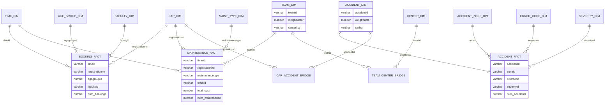

# MonCity Self Driving Car Data Warehouse

> **Coursework.** This project was completed as Assignment 2 for FIT3003 Business Intelligence and Data Warehousing at Monash University. MonCity is a fictional smart city dataset provided for the unit.

A data warehouse built on Oracle for the MonCity self driving car project. It uses seven years (2015 to 2021) of booking, maintenance and accident records to answer one question: **should MonCity invest more in its self driving cars?**

## What is in this repo

```
moncity-data-warehouse/
├── sql/
│   ├── 01_data_cleaning.sql     exploration, data quality checks and cleaned tables
│   ├── 02_build_warehouse.sql   dimensions, bridge tables and fact tables (version 1)
│   └── 03_analysis.sql          olap and analytics queries
├── data/
│   └── warehouse/               csv exports of every warehouse table
└── docs/
    └── poster.pdf               one page summary of the findings
```

## How to run

1. Connect to an Oracle database that can read the `moncity` schema.
2. Run `sql/01_data_cleaning.sql` to check the data and create the cleaned tables.
3. Run `sql/02_build_warehouse.sql` to build the dimensions, bridges and facts.
4. Run `sql/03_analysis.sql` for the analysis queries.

The `moncity` schema is read only, so every table is created in your own account.

## Data cleaning

Six problems were found and fixed before building the warehouse.

| Problem | Fix | Table |
|---|---|---|
| Booking T1218 appears twice with identical values | `select distinct` | `booking_clean` |
| Maintenance M2000 has a cost of -200 | record left out | `maintenance_clean` |
| Accident A2000 uses Error010, which does not exist | record left out | `accidentinfo_clean` |
| One accident has no accident id | record left out | `accidentinfo_clean` |
| Passenger U163 has the faculty "Alienware" | faculty set to null, bookings kept | `passenger_clean` |
| Car accident rows for the two removed accidents | rows dropped | `caraccident_clean` |

## Schema (version 1)

A snowflake schema with three fact tables sharing the time and car dimensions. Two many to many relationships need bridge tables: a maintenance team can belong to several research centres, and an accident can involve several cars.



**Weight factor and list aggregate.** `team_dim` and `accident_dim` each store a weight factor (1 divided by the number of centres or cars) and a list aggregate built with `listagg`. For example, team T001 belongs to all four centres, so its weight factor is 0.25 and its centre list is `CE01_CE02_CE03_CE04`. The weight factor stops double counting when a measure is added up across a bridge.

**Age groups.** Young adults (18 to 35), middle aged adults (36 to 59) and old aged adults (60 and older). The age group is worked out when each booking is loaded, so a booking keeps the group the passenger was in at the time.

## Analysis

`03_analysis.sql` uses `rollup` and `cube` with `grouping`, `rank`, `dense_rank` and `percent_rank`, cumulative and moving aggregates, and simple linear regression.

## Key findings

| | |
|---|---|
| Bookings | 10,000 over 84 months, about 119 a month |
| Fleet | 30 cars, 10 buses, 10 mini buses and 10 people movers |
| Maintenance cost | $302,700 |
| Accidents | 992, close to 1 in every 10 bookings |

1. **Demand is not going up.** A regression on monthly bookings (y = 118.36 + 0.0161x) shows growth of only about 1% across seven years.
2. **Buses cost the most to maintain.** All three body types get about 330 bookings per car, but buses cost $113,500 against $88,600 for mini buses.
3. **People movers have the most accidents.** 371, compared with 323 for mini buses and 305 for buses.
4. **Sensor problems cause the damage.** Low battery was the most common error (369 accidents) but never caused damage. Every damaging accident came from the sensors or an unknown error, and image recognition failure alone caused 51 severe accidents.
5. **Newer cars are not safer.** A regression of accidents against manufacturing year has a slope of 0.74, so a 2014 car is expected to have about 35.6 accidents against 29.7 for a 2006 car.

**Recommendation:** no new cars should be bought. Money should go into fixing the sensing technology (mainly image recognition), better battery management, and replacing old buses with mini buses.

The full summary is in [`docs/poster.pdf`](docs/poster.pdf).

## Tools

Oracle SQL, Power BI Desktop

## Author

Ishan Sharma
